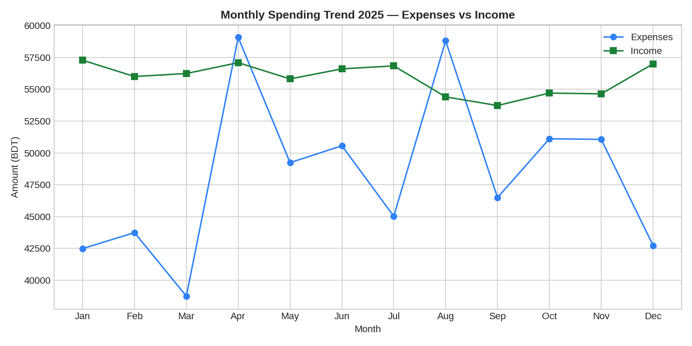
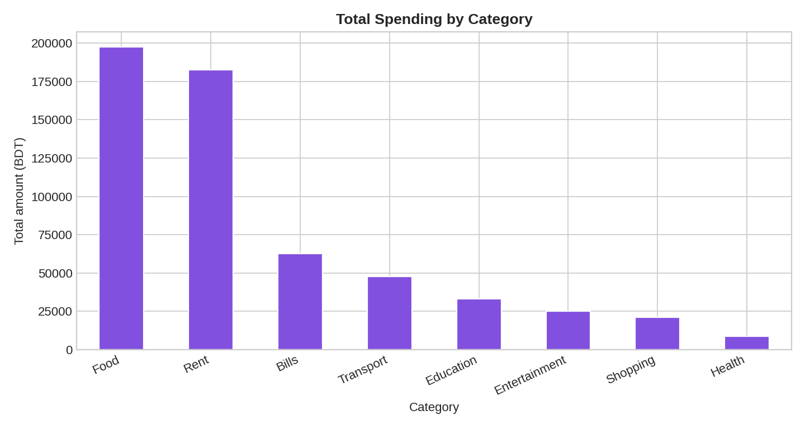

# Personal Expense Tracker Analysis

A complete beginner-friendly **Data Science project** built with **Pandas, NumPy and Matplotlib**. It analyses a year of personal expenses — where the money goes each month, which categories cost the most, and how much is saved against a monthly income.

> The dataset in this project is synthetic practice data generated with NumPy. It is made for learning the full workflow: data generation → cleaning → analysis → visualization → insights.

📖 **New here?** Read the full step-by-step explanation of everything in this project: [PROJECT_GUIDE.md](PROJECT_GUIDE.md)

## Project Highlights

- Generate a realistic expense dataset with **NumPy**
- Clean and explore transactions with **Pandas**
- Compare monthly expenses against income and compute savings rate
- Create summary tables with `groupby`, aggregation and share percentages
- Build clear visualizations with **Matplotlib**

## Questions This Project Answers

1. Which month has the highest spending?
2. Which category takes the biggest share of total spending?
3. How much is saved each month, and what is the average savings rate?
4. Do essential expenses dominate, or non-essential ones?
5. Which payment method is used for the largest spending?

## Dataset Columns

| Column | Meaning |
|---|---|
| `date` | Transaction date in 2025 |
| `month` | Month number, 1–12 |
| `category` | Food, Transport, Rent, Shopping, Bills, Entertainment, Health or Education |
| `amount_bdt` | Transaction amount in Bangladeshi Taka |
| `payment_method` | Cash, bKash, Nagad or Card |
| `is_essential` | True for essential categories (Food, Transport, Rent, Bills, Health, Education) |

Monthly income is modelled inside the analysis as a fixed salary of **55,000 BDT/month** plus small variation, so savings and savings rate can be calculated per month.

## Project Structure

```text
personal-expense-tracker-analysis/
├── README.md
├── requirements.txt
├── data/
│   └── personal_expenses_2025.csv
├── src/
│   ├── generate_dataset.py
│   └── analysis.py
├── notebooks/
│   └── personal_expense_analysis.ipynb
└── outputs/
    ├── insights.md
    ├── tables/
    │   ├── summary_statistics.csv
    │   ├── monthly_spending_summary.csv
    │   ├── spending_by_category.csv
    │   └── spending_by_payment_method.csv
    └── charts/
        ├── monthly_spending_trend.png
        ├── spending_by_category.png
        ├── essential_vs_non_essential.png
        └── daily_spending_distribution.png
```

## Quick Start

```bash
git clone <your-repository-url>
cd personal-expense-tracker-analysis
pip install -r requirements.txt
python src/generate_dataset.py
python src/analysis.py
```

After running the analysis, open:

- `outputs/insights.md` for the key findings
- `outputs/charts/` for all visualizations
- `outputs/tables/` for the summary CSV files

## Sample Visualizations





## Tools Used

- **Python**
- **Pandas** — data cleaning, grouping and analysis
- **NumPy** — synthetic data generation and numerical work
- **Matplotlib** — charts

## Future Improvements

- Replace the synthetic dataset with real exported transactions
- Add budget limits per category and alert when a category crosses its budget
- Train a simple model to forecast next month's spending
- Build an interactive dashboard with Streamlit

## Note

This project is for Data Science practice with synthetic data. Keep real personal financial data private.
